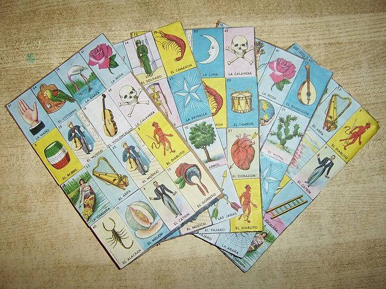

# Mexican Lotería

*Also known as: Lotería · picture bingo*

**Encyclopedia ID 935** (permanent) · https://bpupadhyaya.github.io/world-heritage-games-site/games/935-mexican-loteria/

*Photo: Unknown author (public domain), [Public domain](https://creativecommons.org/publicdomain/mark/1.0/), [source on Wikimedia Commons](https://commons.wikimedia.org/wiki/File:Loteria_boards.jpg)*

A caller (cantor) draws pictures from a 54-card deck, announcing each with a rhyme, and players mark matching pictures on 4x4 tablas; first to fill a line, corners or the centre shouts Lotería.

## Heritage note

Part of the living heritage of Mexico.

## Origins

Usually placed in the era of Crossroads and Golden Ages (about 500 to 1500), although its exact origins are uncertain, within the cultural world of The Americas: Mesoamerica.

## Facts

- **Where:** Mexico
- **Type:** Board and table games
- **Era:** [Crossroads and Golden Ages](../../eras/crossroads/index.md) (uncertain)
- **Cradle:** [The Americas: Mesoamerica](../../cradles/meso-america/index.md)
- **Region:** Americas
- **Players:** 2-10+

## Play it

[Web preview](https://bpupadhyaya.github.io/games-site/games/loteria-cantada-tablas/) · [Google Play](https://play.google.com/store/apps/details?id=com.equalinformation.arcforge.shell) · [App Store](https://apps.apple.com/us/app/arcforge-world-heritage-games/id6813746442)

## Related entries

- [Patolli](../../games/454-patolli/index.md)
- [Puluc](../../games/757-puluc/index.md)
- [Guatemalan Lotería](../../games/758-guatemalan-loteria/index.md)
- [Charro lasso roping](../../games/60-charro-lasso-roping/index.md)
- [Pinata swing](../../games/61-pinata-swing/index.md)
- [Alebrije painting](../../games/92-alebrije-painting/index.md)

## Sources

- <https://en.wikipedia.org/wiki/Loter%C3%ADa>
- <https://en.wikipedia.org/wiki/Traditional_games_of_Mexico>
- <https://www.mexicodesconocido.com.mx/juguetes-tradicionales-mexicanos.html>
