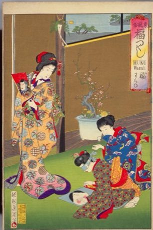

# Fukuwarai

*Also known as: 福笑い · blindfold face-building*

**Encyclopedia ID 94** (permanent) · https://bpupadhyaya.github.io/world-heritage-games-site/games/94-fukuwarai/

*Photo: Toyohara Chikanobu, [Public domain](https://creativecommons.org/publicdomain/mark/1.0/), [source on Wikimedia Commons](https://commons.wikimedia.org/wiki/File:NDL-DC_1309703_Toyohara_Chikanobu_福わらひ_crd.jpg)*

A blindfolded player places eyes, nose, brows and mouth on an empty face outline; the result is revealed and usually hilarious.

## Heritage note

Part of the living heritage of Japan.

## Origins

Usually placed in the era of Age of Contact and Craft (about 1500 to 1800), although its exact origins are uncertain, within the cultural world of Japan and Korea.

## Facts

- **Where:** Japan
- **Type:** Puzzles and mind games
- **Family:** Puzzle and dexterity toys
- **Era:** [Age of Contact and Craft](../../eras/contact/index.md) (uncertain)
- **Cradle:** [Japan and Korea](../../cradles/japan-korea/index.md)
- **Region:** East and Southeast Asia

## Related entries

- [Sangaku Geometry Puzzles](../../games/109-sangaku-geometry-puzzles/index.md)
- [Kingyo-sukui](../../games/3-kingyo-sukui/index.md)
- [Charro lasso roping](../../games/60-charro-lasso-roping/index.md)
- [Daruma Otoshi](../../games/63-daruma-otoshi/index.md)
- [Lo Shu Magic Square](../../games/111-lo-shu-magic-square/index.md)
- [Intha leg rowing on the lake](../../games/304-intha-leg-rowing-on-the-lake/index.md)

## Sources

- <https://commons.wikimedia.org/wiki/File:NDL-DC_1309703_Toyohara_Chikanobu_福わらひ_crd.jpg>
