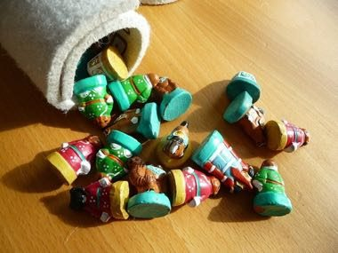

# Mongolian chess

*Also known as: Монгол шатар Mongol shatar · Shatar · Shatar (Mongolian chess)*

**Encyclopedia ID 943** (permanent) · https://bpupadhyaya.github.io/world-heritage-games-site/games/943-mongolian-chess/

*Photo: Immanuel Giel, [CC BY-SA 3.0](https://creativecommons.org/licenses/by-sa/3.0/), [source on Wikimedia Commons](https://commons.wikimedia.org/wiki/File:Shatar-03.JPG)*

Chess variant with Mongolian piece names (noyon, bars, temee, mor, tereg, khuu); the queen moves like a rook or one step diagonally and play opens with d4/d5.

## Heritage note

Part of the living heritage of Mongolia.

## Origins

Usually placed in the era of Crossroads and Golden Ages (about 500 to 1500), although its exact origins are uncertain, within the cultural world of Steppe and Arctic.

## Facts

- **Where:** Mongolia
- **Type:** Board and table games
- **Family:** Chess family
- **Era:** [Crossroads and Golden Ages](../../eras/crossroads/index.md) (uncertain)
- **Cradle:** [Steppe and Arctic](../../cradles/steppe-arctic/index.md)
- **Region:** East and Southeast Asia
- **Players:** 2

## Related entries

- [Chaturanga](../../games/45-chaturanga/index.md)
- [Sittuyin](../../games/302-sittuyin/index.md)
- [Banqi](../../games/1437-banqi/index.md)
- [Chess](../../games/552-chess/index.md)
- [Khmer chess](../../games/616-khmer-chess/index.md)
- [Xiangqi](../../games/636-xiangqi/index.md)

## Sources

- <https://en.wikipedia.org/wiki/Mongolian_chess>
- <https://en.wikipedia.org/wiki/Mongolian_Chess_Championship>
- <https://www.discovermongolia.mn/about-mongolia/culture-art-history/mongolian-toys-and-games>
- <https://commons.wikimedia.org/wiki/File:Shatar-03.JPG>
