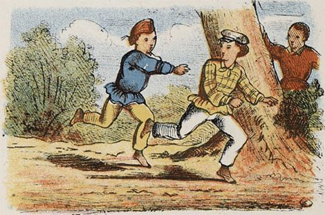

# Tag

*Also known as: Zum-zum · Htote si toe*

**Encyclopedia ID 959** (permanent) · https://bpupadhyaya.github.io/world-heritage-games-site/games/959-tag/

*Photo: Anonymous Unknown author, [Public domain](https://creativecommons.org/publicdomain/mark/1.0/), [source on Wikimedia Commons](https://commons.wikimedia.org/wiki/File:Jongensspelen_10.jpg)*

Border-crossing tag games where raiders try to cross lines without being tagged by defenders.

## Heritage note

Part of the living heritage of Myanmar.

## Origins

Usually placed in the era of Deep Past and First Games (before about 3000 BCE), although its exact origins are uncertain, within the cultural world of Southeast Asia and the Islands.

## Facts

- **Where:** Myanmar
- **Type:** Street and playground games
- **Family:** Tag, chase and hide games
- **Era:** [Deep Past and First Games](../../eras/deep-past/index.md) (uncertain)
- **Cradle:** [Southeast Asia and the Islands](../../cradles/southeast-asia/index.md)
- **Region:** East and Southeast Asia
- **Players:** teams

## Related entries

- [Galah panjang](../../games/909-galah-panjang/index.md)
- [Patintero](../../games/1021-patintero/index.md)
- [Hide and Seek](../../games/475-hide-and-seek/index.md)
- [Brännboll](../../games/1118-brannboll/index.md)
- [Ziziros](../../games/659-ziziros/index.md)
- [Fijian tag](../../games/712-fijian-tag/index.md)

## Sources

- <https://en.wikipedia.org/wiki/Traditional_games_of_Myanmar>
