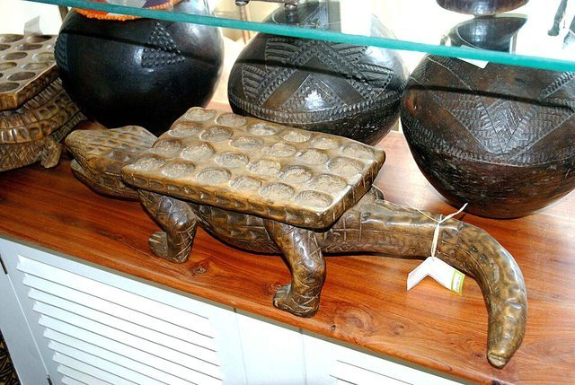

# Owela

*Also known as: Hus*

**Encyclopedia ID 960** (permanent) · https://bpupadhyaya.github.io/world-heritage-games-site/games/960-owela/

*Photo: Moongateclimber, [Public domain](https://creativecommons.org/publicdomain/mark/1.0/), [source on Wikimedia Commons](https://commons.wikimedia.org/wiki/File:Hus_(Omwela)_board_for_sale_in_Swakopmund,_Namibia.jpg)*

Four-row mancala widely played across Namibian peoples.

## Heritage note

Part of the living heritage of Namibia.

## Origins

Usually placed in the era of Deep Past and First Games (before about 3000 BCE), although its exact origins are uncertain, within the cultural world of Africa: Southern Africa.

## Facts

- **Where:** Namibia
- **Type:** Board and table games
- **Family:** Mancala and sowing games
- **Era:** [Deep Past and First Games](../../eras/deep-past/index.md) (uncertain)
- **Cradle:** [Africa: Southern Africa](../../cradles/africa-south/index.md)
- **Region:** Sub-Saharan Africa
- **Players:** 2

## Related entries

- [Kiela](../../games/544-kiela/index.md)
- [Ntxuva](../../games/954-ntxuva/index.md)
- [Tchouba](../../games/955-tchouba/index.md)
- [Moruba / Ncuva](../../games/1080-moruba-ncuva/index.md)
- [Tsoro](../../games/1222-tsoro/index.md)
- [Songo](../../games/617-songo/index.md)

## Sources

- <https://en.wikipedia.org/wiki/Owela>
- <https://www.namibian.com.na/owela-plays-two-inventors/>
