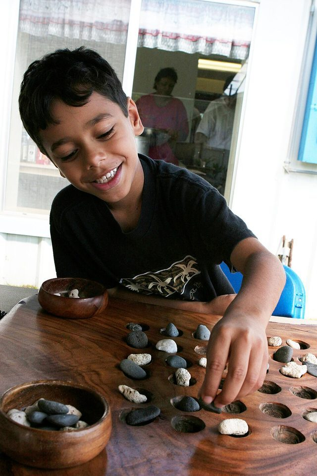

# Kōnane

**Encyclopedia ID 961** (permanent) · https://bpupadhyaya.github.io/world-heritage-games-site/games/961-konane/

*Photo: Cpl. Rich Mattingly, [Public domain](https://creativecommons.org/publicdomain/mark/1.0/), [source on Wikimedia Commons](https://commons.wikimedia.org/wiki/File:USMC-14131.jpg)*

Two players jump orthogonally over opponent stones on a grid, removing them; last player able to move wins.

## Heritage note

Part of the living heritage of United States.

## Origins

Usually placed in the era of Crossroads and Golden Ages (about 500 to 1500), although its exact origins are uncertain, within the cultural world of Pacific and Oceania.

## Facts

- **Where:** United States
- **Type:** Board and table games
- **Era:** [Crossroads and Golden Ages](../../eras/crossroads/index.md) (uncertain)
- **Cradle:** [Pacific and Oceania](../../cradles/pacific/index.md)
- **Region:** Americas
- **Players:** 2

## Play it

[Web preview](https://bpupadhyaya.github.io/games-site/games/konane-hawaiian-jumps/) · [Google Play](https://play.google.com/store/apps/details?id=com.equalinformation.arcforge.shell) · [App Store](https://apps.apple.com/us/app/arcforge-world-heritage-games/id6813746442)

## Related entries

- [Wayfinder](../../games/43-wayfinder/index.md)
- [Yap stone money trade puzzle](../../games/1401-yap-stone-money-trade-puzzle/index.md)
- [Mu Torere](../../games/979-mu-torere/index.md)
- ['Ulu Maika](../../games/44-ulu-maika/index.md)
- [Ukulele strum-along](../../games/144-ukulele-strum-along/index.md)
- [Lei making](../../games/449-lei-making/index.md)

## Sources

- <https://en.wikipedia.org/wiki/K%C5%8Dnane>
