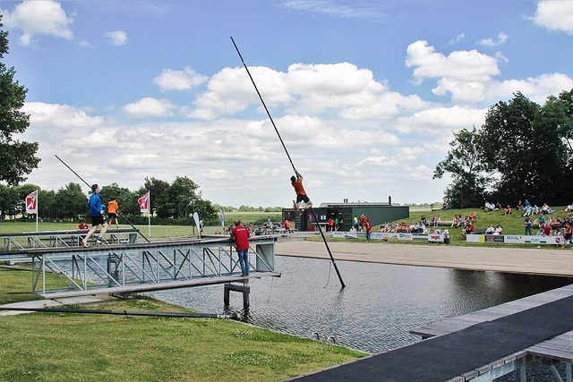

# Fierljeppen

*Also known as: Pole vaulting over canals*

**Encyclopedia ID 971** (permanent) · https://bpupadhyaya.github.io/world-heritage-games-site/games/971-fierljeppen/

*Photo: Peter van der Sluijs, [CC BY-SA 4.0](https://creativecommons.org/licenses/by-sa/4.0/), [source on Wikimedia Commons](https://commons.wikimedia.org/wiki/File:Fierljeppen_in_Linschoten.jpg)*

Run, grab a pole and climb to leap a canal; Frisian farmer tradition.

## Heritage note

Part of the living heritage of Netherlands.

## Origins

Usually placed in the era of Modern Heritage (1800 to today), although its exact origins are uncertain, within the cultural world of Celtic and Atlantic Europe.

## Facts

- **Where:** Netherlands
- **Type:** Street and playground games
- **Era:** [Modern Heritage](../../eras/modern/index.md) (uncertain)
- **Cradle:** [Celtic and Atlantic Europe](../../cradles/celtic-atlantic/index.md)
- **Region:** Europe
- **Players:** individual

## Related entries

- [Canal pole vault](../../games/7-canal-pole-vault/index.md)
- [Sjoelen](../../games/9-sjoelen/index.md)
- [Korfball](../../games/481-korfball/index.md)
- [Klootschieten](../../games/975-klootschieten/index.md)
- [Frisian kaatsen](../../games/973-frisian-kaatsen/index.md)
- [Disc-flip](../../games/8-disc-flip/index.md)

## Sources

- <https://en.wikipedia.org/wiki/Fierljeppen>
