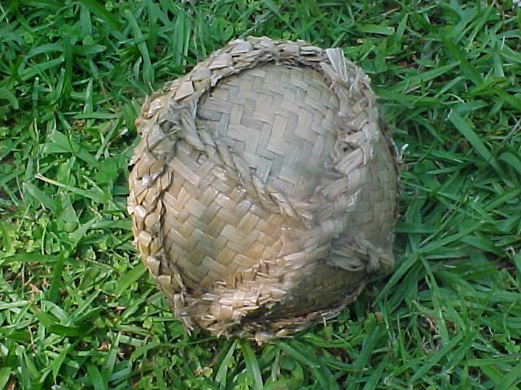

# Kī-o-rahi

**Encyclopedia ID 978** (permanent) · https://bpupadhyaya.github.io/world-heritage-games-site/games/978-ki-o-rahi/

*Photo: Sossos, [CC BY-SA 3.0](https://creativecommons.org/licenses/by-sa/3.0/), [source on Wikimedia Commons](https://commons.wikimedia.org/wiki/File:Ki_on_grass1.jpg)*

Fast circular-field ball game between a defending team and an attacking team, scoring by touching a central marker.

## Heritage note

Part of the living heritage of New Zealand.

## Origins

Usually placed in the era of Modern Heritage (1800 to today), although its exact origins are uncertain, within the cultural world of Pacific and Oceania.

## Facts

- **Where:** New Zealand
- **Type:** Street and playground games
- **Era:** [Modern Heritage](../../eras/modern/index.md) (uncertain)
- **Cradle:** [Pacific and Oceania](../../cradles/pacific/index.md)
- **Region:** Oceania and Pacific
- **Players:** 7 v 7

## Related entries

- [Gumboot throwing](../../games/448-gumboot-throwing/index.md)
- [Maori stick games](../../games/981-maori-stick-games/index.md)
- [Wave riding](../../games/76-wave-riding/index.md)
- [Netball](../../games/447-netball/index.md)
- [Hand-slap game](../../games/711-hand-slap-game/index.md)
- [Ibibo](../../games/964-ibibo/index.md)

## Sources

- <https://teara.govt.nz/en/traditional-maori-games-nga-takaro/print>
- <https://teara.govt.nz/en/photograph/39363/a-game-of-ki-o-rahi>
- <https://teara.govt.nz/en/traditional-maori-games-nga-takaro>
- <https://www.r2r.org.nz/games-activities-maori-youth/ki-o-rahi.html>
