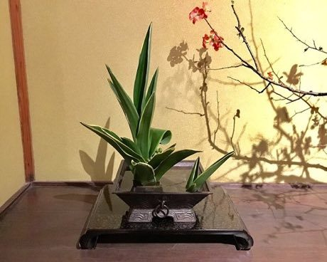

# Ikebana

*Also known as: 生け花 · flower arrangement*

**Encyclopedia ID 98** (permanent) · https://bpupadhyaya.github.io/world-heritage-games-site/games/98-ikebana/

*Photo: Gryffindor, [CC0](https://creativecommons.org/publicdomain/zero/1.0/), [source on Wikimedia Commons](https://commons.wikimedia.org/wiki/File:Ikebana_exhibition_at_Meguro_Gajoen_2018_10.jpg)*

Choose stems and place them at set angles and heights in a vase to meet a style guide, then get scored on balance and space.

## Heritage note

Part of the living heritage of Japan. Some forms of this practice carry deep meaning for the communities who keep it; here we describe the play and the craft only, with respect for its roots.

## Origins

A living tradition passed from person to person; it is not tied to a single dated origin. It belongs to the cultural world of Japan and Korea.

## Facts

- **Where:** Japan
- **Type:** Crafts and making
- **Era:** [Living Traditions](../../eras/living/index.md)
- **Cradle:** [Japan and Korea](../../cradles/japan-korea/index.md)
- **Region:** East and Southeast Asia

## Related entries

- [Sashiko Stitch Patterns](../../games/27-sashiko-stitch-patterns/index.md)
- [Karesansui](../../games/95-karesansui/index.md)
- [Temari Thread-Ball Patterns](../../games/96-temari-thread-ball-patterns/index.md)
- [Kumiko lattice](../../games/97-kumiko-lattice/index.md)
- [Shibori Indigo Fold](../../games/106-shibori-indigo-fold/index.md)
- [Kumihimo Braid Disk](../../games/107-kumihimo-braid-disk/index.md)

## Sources

- <https://commons.wikimedia.org/wiki/File:Ikebana_exhibition_at_Meguro_Gajoen_2018_10.jpg>
