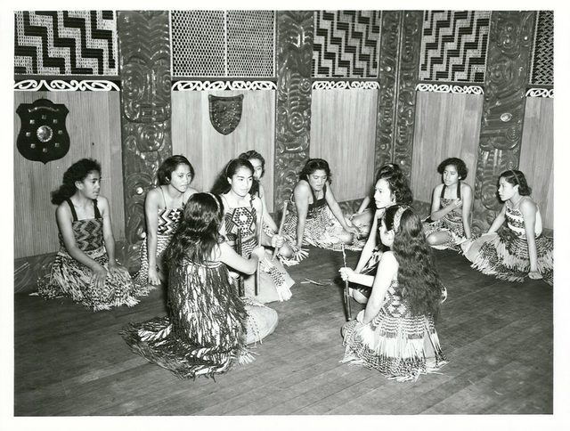

# Maori stick games

*Also known as: Tītī tōrea*

**Encyclopedia ID 981** (permanent) · https://bpupadhyaya.github.io/world-heritage-games-site/games/981-maori-stick-games/

*Photo: Archives New Zealand, [CC BY 2.0](https://creativecommons.org/licenses/by/2.0/), [source on Wikimedia Commons](https://commons.wikimedia.org/wiki/File:Whakarewarewa_Maori_School_-_Stick_Games.jpg)*

Rhythmic partner game passing and tossing short sticks, often with song.

## Heritage note

Part of the living heritage of New Zealand.

## Origins

Usually placed in the era of Modern Heritage (1800 to today), although its exact origins are uncertain, within the cultural world of Pacific and Oceania.

## Facts

- **Where:** New Zealand
- **Type:** Dexterity and skill games
- **Family:** Puzzle and dexterity toys
- **Era:** [Modern Heritage](../../eras/modern/index.md) (uncertain)
- **Cradle:** [Pacific and Oceania](../../cradles/pacific/index.md)
- **Region:** Oceania and Pacific
- **Players:** 2+

## Related entries

- [Marshallese stick chart navigator](../../games/1333-marshallese-stick-chart-navigator/index.md)
- [Sand drawing](../../games/1395-sand-drawing/index.md)
- [Heu](../../games/1146-heu/index.md)
- [Hiko](../../games/1147-hiko/index.md)
- [Kingyo-sukui](../../games/3-kingyo-sukui/index.md)
- [Stone Skipping](../../games/5-stone-skipping/index.md)

## Sources

- <https://en.wikipedia.org/wiki/T%C4%ABt%C4%AB_t%C5%8Drea>
- <https://digitalnz.org/stories/5e5618ad6d3909000a7b878e>
