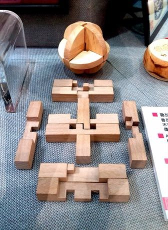

# Luban lock

*鲁班锁 / 孔明锁 · Kongming lock interlocking puzzle*

**Encyclopedia ID 99** (permanent) · https://bpupadhyaya.github.io/world-heritage-games-site/games/99-luban-lock/

*Photo: Pauloleong2002, [CC BY-SA 4.0](https://creativecommons.org/licenses/by-sa/4.0/), [source on Wikimedia Commons](https://commons.wikimedia.org/wiki/File:Burr_puzzle_-_exhibited_in_Macau.jpg)*

Interlocking notched wooden sticks must be taken apart and reassembled without glue or nails; each sixth piece slides in last.

## Heritage note

Part of the living heritage of China. Some forms of this practice carry deep meaning for the communities who keep it; here we describe the play and the craft only, with respect for its roots.

## Origins

Usually placed in the era of Modern Heritage (1800 to today), although its exact origins are uncertain, within the cultural world of China.

## Facts

- **Where:** China
- **Type:** Puzzles and mind games
- **Family:** Puzzle and dexterity toys
- **Era:** [Modern Heritage](../../eras/modern/index.md) (uncertain)
- **Cradle:** [China](../../cradles/china/index.md)
- **Region:** East and Southeast Asia

## Related entries

- [Huarong Dao](../../games/639-huarong-dao/index.md)
- [Tangram](../../games/641-tangram/index.md)
- [Kingyo-sukui](../../games/3-kingyo-sukui/index.md)
- [Stone Skipping](../../games/5-stone-skipping/index.md)
- [Disc-flip](../../games/8-disc-flip/index.md)
- [Sjoelen](../../games/9-sjoelen/index.md)

## Sources

- <https://commons.wikimedia.org/wiki/File:Burr_puzzle_-_exhibited_in_Macau.jpg>
